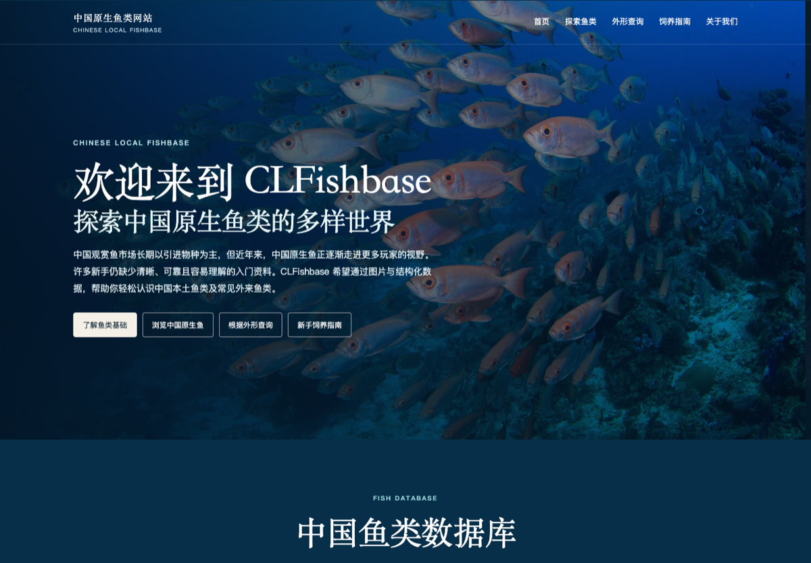
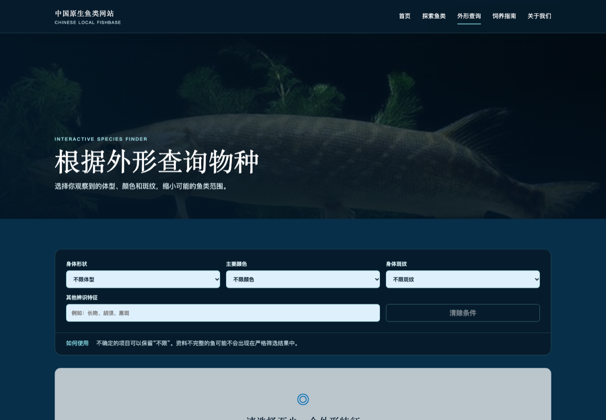
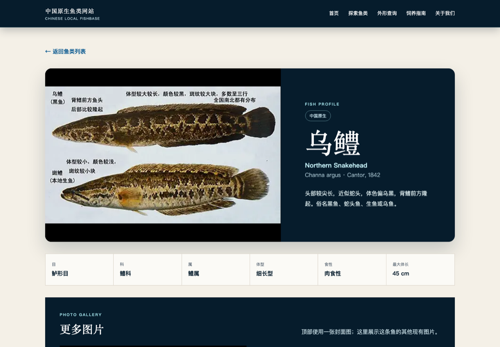
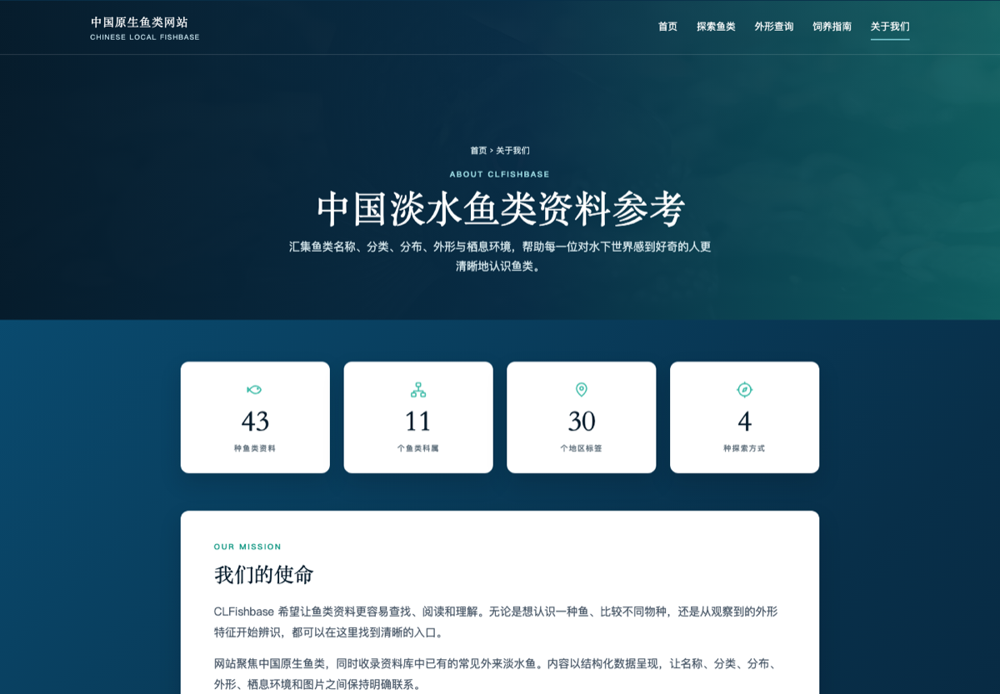
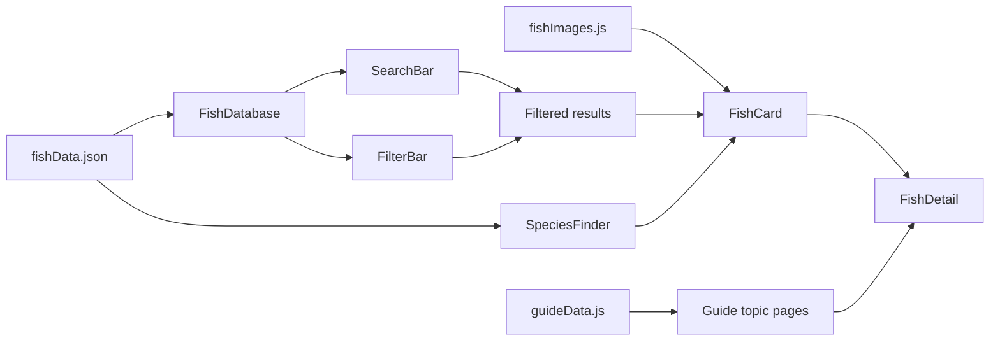

# CLFishbase · 中国原生鱼类网站

<p align="center">
  <strong>A bilingual, data-driven reference experience for exploring freshwater fish in China.</strong><br />
  一个以本地 JSON 数据驱动，结合物种检索、外形查询与淡水鱼饲养科普的响应式 React 网站。
</p>

<p align="center">
  
  
  
  
  
</p>



## Table of contents

- [Project overview](#project-overview)
- [At a glance](#at-a-glance)
- [Product walkthrough](#product-walkthrough)
  - [Searchable fish database](#1-searchable-fish-database)
  - [Appearance-based species finder](#2-appearance-based-species-finder)
  - [Reusable fish profiles](#3-reusable-fish-profiles)
  - [Structured freshwater care guide](#4-structured-freshwater-care-guide)
  - [Project context and data transparency](#5-project-context-and-data-transparency)
- [Core interaction design](#core-interaction-design)
  - [State and filtering](#state-and-filtering)
  - [Navigation without a routing dependency](#navigation-without-a-routing-dependency)
- [Data model](#data-model)
- [Component architecture](#component-architecture)
- [Visual system and accessibility](#visual-system-and-accessibility)
- [Technical stack](#technical-stack)
- [Run locally](#run-locally)
  - [Prerequisites](#prerequisites)
  - [Installation](#installation)
  - [Available scripts](#available-scripts)
- [Reliability and data integrity](#reliability-and-data-integrity)
- [Content and asset note](#content-and-asset-note)
- [Design and engineering decisions](#design-and-engineering-decisions)
- [Future development](#future-development)
- [Portfolio focus](#portfolio-focus)

## Project overview

CLFishbase is a Chinese-language fish reference and learning website built as a portfolio project with React, Vite and plain CSS. It turns a structured local JSON file into an explorable interface instead of relying on a backend or a third-party data API.

The experience is designed around three questions:

1. **What fish is this?** Search by Chinese name, English name or scientific name, then refine by family, region and body shape.
2. **What could this fish be?** Use visible characteristics—shape, colour, pattern and keywords—to narrow possible species.
3. **How should a beginner care for freshwater fish?** Read topic-based guidance covering preparation, aquarium ecosystems, routine maintenance, fish health and common questions.

The project deliberately keeps the implementation approachable: React state, array methods and reusable components are visible in the code, while the finished interface feels like a coherent information product.

## At a glance

| Project metric | Verified value |
| --- | ---: |
| Raw records in `fishData.json` | 47 |
| Unique species IDs rendered by the app | 43 |
| Family values represented | 11 |
| Distinct region codes | 20 |
| Local fish image files | 80 |
| Local cover images resolved by the image map | 43 / 43 |
| Care-guide topic pages | 4 |

> The source JSON currently contains four repeated IDs. The interface keeps the first record for each ID when rendering lists, so React keys and cards remain unique. The original data file is not silently rewritten.

## Product walkthrough

### 1. Searchable fish database

The homepage combines editorial introduction with a database generated from JSON. Search and filters work together with logical **AND** conditions, and all filter options are derived from fields that actually exist in the dataset.


- Search across `chineseName`, `englishName` and `scientificName`
- Filter by `taxonomy.family`, `identification.regions` and `identification.bodyShape`
- Generate result cards with `.filter()` and `.map()`
- Show the live number of matching fish
- Provide a clear empty state and one-click reset
- Keep missing optional values out of the UI instead of displaying `undefined` or inventing content

### 2. Appearance-based species finder

Visitors can describe an observed fish through body shape, primary colour, pattern and free-text identifying features. The tool only matches recorded fields and explicitly avoids guessing when evidence is missing.



### 3. Reusable fish profiles

Every result card can open a shared detail view. The detail page combines taxonomy, identification, habitat information and a local photo gallery while preserving the visitor's previous page in browser history.



### 4. Structured freshwater care guide

The guide is divided into four focused routes rather than one oversized article:

- 养鱼前的准备 · Preparation before choosing fish
- 鱼缸生态系统搭建 · Aquarium ecosystem setup
- 日常维护 · Routine maintenance
- 鱼类健康观察 · Fish health observation

Topic cards open dedicated reading views with their own section navigation. Fish recommendations reuse the visual language of the database cards and connect to corresponding fish profiles where data is available. The FAQ remains part of the guide rather than pretending to be a community or backend-supported Q&A system.


### 5. Project context and data transparency

The About page introduces the purpose and scope of CLFishbase, summarizes the available data, and explains how structured information supports different ways of exploring fish.



## Core interaction design



### State and filtering

The central database uses local component state rather than a global state library:

```jsx
const [searchTerm, setSearchTerm] = useState("");
const [selectedFamily, setSelectedFamily] = useState("all");
const [selectedRegion, setSelectedRegion] = useState("all");
const [selectedBodyShape, setSelectedBodyShape] = useState("all");

const filteredFish = uniqueFishData.filter((fish) => {
  // Search and every active filter must match.
  return matchesSearch && matchesFamily && matchesRegion && matchesBodyShape;
});
```

### Navigation without a routing dependency

The app uses query parameters plus the browser History API:

- `?page=identify` opens the appearance finder
- `?page=guide` opens the guide landing page
- `?page=guide-ecosystem` opens one guide topic
- `?page=about` opens the About page
- `?fish=channa-argus&from=home` opens a fish profile and remembers its origin

`pushState`, `replaceState` and the `popstate` event keep browser Back/Forward behavior consistent without adding React Router. This was a deliberate learning constraint, not a recommendation against using a router in a larger production application.

## Data model

The interface reads the real nested structure of each fish object. Representative paths include:

```text
fish.id
fish.chineseName
fish.englishName
fish.scientificName
fish.taxonomy.family
fish.identification.waterType
fish.identification.regions
fish.identification.bodyShape
fish.appearance.primaryColors
fish.appearance.patterns
fish.habitat.description
fish.images.cover.alt
```

Image rendering uses a checked local mapping in `src/data/fishImages.js`. URLs are encoded where folder names contain spaces, and cards use a same-size light-blue CSS placeholder if an image fails to load. This prevents broken-image icons from destabilizing the card layout.

## Component architecture

```text
fish-website/
├── docs/
│   └── images/                 # README screenshots
├── public/
│   └── images/fish/            # Local fish image library
├── src/
│   ├── components/
│   │   ├── AboutPage.jsx
│   │   ├── BackToTop.jsx
│   │   ├── BeginnerGuide.jsx
│   │   ├── FilterBar.jsx
│   │   ├── FishCard.jsx
│   │   ├── FishDatabase.jsx
│   │   ├── FishDetail.jsx
│   │   ├── Footer.jsx
│   │   ├── GuideNavigation.jsx
│   │   ├── GuideTopicPage.jsx
│   │   ├── Hero.jsx
│   │   ├── Navbar.jsx
│   │   ├── SearchBar.jsx
│   │   └── SpeciesFinder.jsx
│   ├── data/
│   │   ├── fishData.json       # Local structured species records
│   │   ├── fishImages.js       # Verified image paths by fish ID
│   │   └── guideData.js        # Guide sections, recommendations and FAQ
│   ├── App.jsx                 # Page composition and navigation history
│   ├── App.css                 # Responsive ocean-themed design system
│   └── main.jsx                # React entry point
├── index.html
├── package.json
└── vite.config.js
```

Each component has one main responsibility. `FishDatabase` owns search/filter state, `FilterBar` renders filter controls, `FishCard` presents one record, and `FishDetail` presents the selected record. This separation makes data flow easy to trace in a classroom or code review.

## Visual system and accessibility

The interface uses a restrained ocean palette and plain CSS—no UI framework:

| Token | Value | Role |
| --- | --- | --- |
| Deep navy | `#061c2c` | Navigation, overlays and high-contrast panels |
| Navy | `#082f49` | Main ocean background |
| Ocean blue | `#07578f` | Actions and selected states |
| Ocean light | `#0b74b8` | Interactive emphasis |
| Aqua | `#78c6d0` | Labels, borders and focus accents |

Accessibility considerations include:

- Semantic landmarks such as `header`, `nav`, `main`, `section` and `footer`
- Meaningful image `alt` text sourced from data where available
- Real labels for search fields and select controls
- Keyboard-operable buttons and links
- Visible focus outlines
- Text labels in addition to colour-only states
- Responsive one-, two- and three-column card layouts
- A `prefers-reduced-motion` fallback
- A global Back to Top control for long reading pages

## Technical stack

- **React 18** — component composition and local state
- **Vite 6** — development server and production bundling
- **JavaScript / JSX** — no TypeScript layer, keeping the learning path direct
- **Plain CSS** — responsive layout, tokens, hover/focus states and scroll snapping
- **Local JSON** — species records without a backend
- **History API** — shareable views and browser navigation without a routing package

No state-management library, UI kit, carousel package, backend database or external fish-data API is required.

## Run locally

### Prerequisites

- Node.js 18 or newer
- npm 9 or newer

### Installation

```bash
git clone https://github.com/nnanwang/fish-website-project.git
cd fish-website-project
npm install
npm run dev
```

Open the local URL printed by Vite, normally `http://localhost:5173`.

### Available scripts

| Command | Purpose |
| --- | --- |
| `npm run dev` | Start the Vite development server |
| `npm run build` | Create an optimized production build in `dist/` |
| `npm run preview` | Preview the production build locally |

## Reliability and data integrity

- All primary fish cards are generated from JSON; species are not hand-written into JSX.
- Missing optional fields are handled defensively and hidden when appropriate.
- Duplicate source IDs are deduplicated at render time without mutating the dataset.
- The 43 mapped cover paths were checked against files in `public/`.
- Failed images fall back to a designed placeholder instead of a broken browser icon.
- Appearance matching uses recorded evidence only and does not infer undocumented traits.
- Production builds are verified with `npm run build` before release.

## Content and asset note

Species data, care-guide material and image assets retain their original source context. This repository does **not** invent missing citations, image licences or scientific evidence. Some guide cover imagery is loaded from external URLs supplied during content development; availability and reuse rights remain subject to the original providers' terms.

Before using the project commercially or redistributing its imagery, review every asset's licence and attribution requirements. The software implementation can be evaluated independently from third-party content rights.

## Design and engineering decisions

| Challenge | Response |
| --- | --- |
| Source JSON contains repeated IDs | Deduplicate only for rendering; preserve the source file |
| Files and data use inconsistent image naming | Maintain one explicit, verified `fishImages.js` map |
| Long guide content is difficult to scan | Divide it into four topic pages with local section navigation |
| A single-page app must support browser Back | Persist views in query parameters and the History API |
| Some records may lack optional values | Use safe access, conditional rendering and neutral placeholders |
| Beginners need readable implementation | Prefer React state and native array methods over abstractions |

## Future development

- Add a documented data-validation script for duplicate IDs and missing fields
- Add automated component and interaction tests
- Replace remaining externally hosted guide covers with reviewed local assets
- Add source and licence metadata at the individual image level
- Introduce a dedicated router if the number of routes continues to grow
- Expand bilingual content and terminology support
- Perform a formal WCAG audit with assistive-technology testing

## Portfolio focus

This project demonstrates:

- Translating a content-heavy brief into a coherent information architecture
- Modelling UI directly from nested JSON
- Building reusable React components and controlled form inputs
- Combining search and multiple filters with predictable state
- Designing responsive layouts without a UI framework
- Handling imperfect real-world data without fabricating missing content
- Iterating from a simple landing page into a multi-view product while preserving usability

---

<p align="center">
  <strong>CLFishbase · 中国原生鱼类网站</strong><br />
  Explore species through structured data, visual characteristics and practical learning content.
</p>
